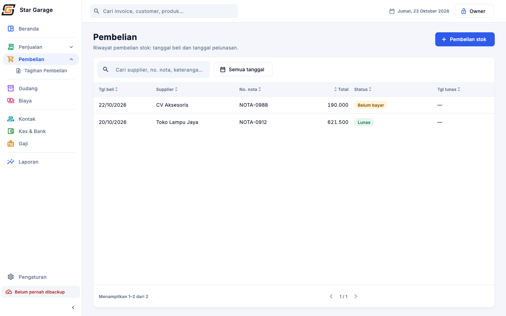
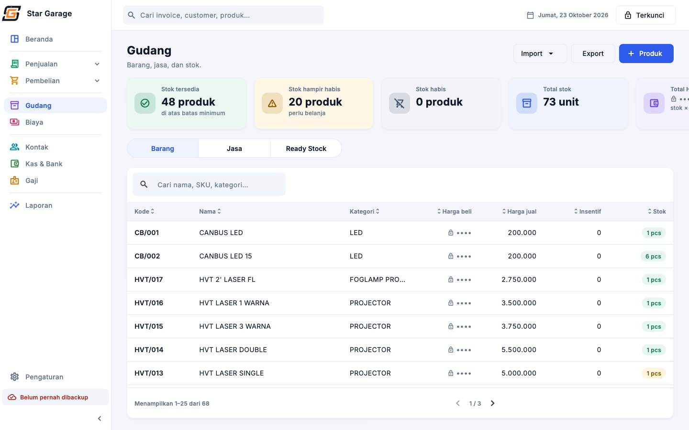
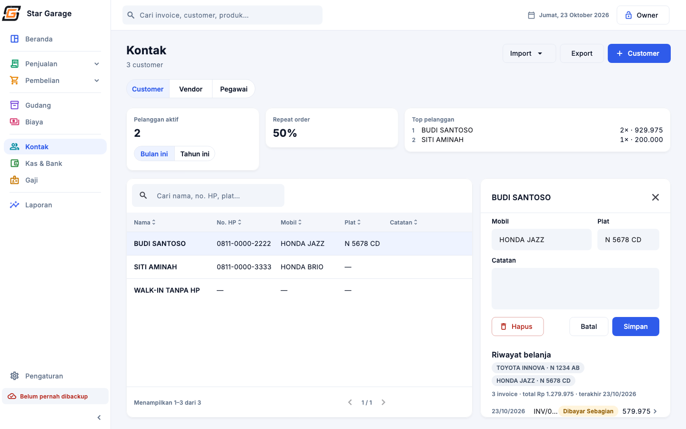
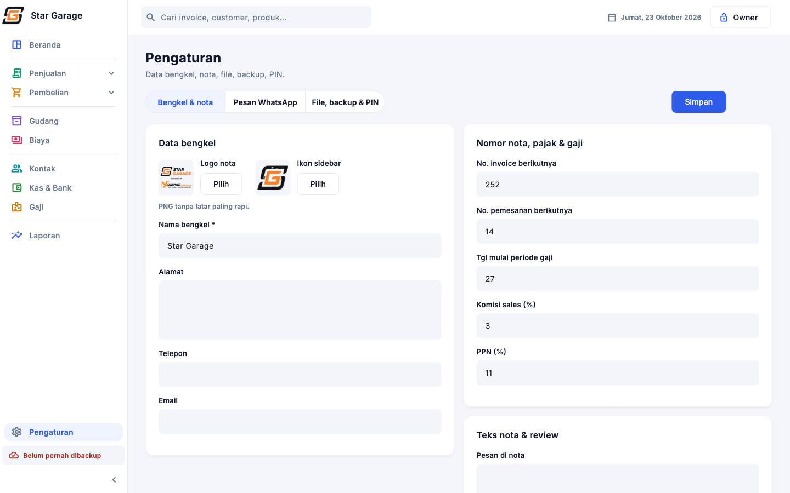

# Garage ERP

Aplikasi desktop **macOS** untuk bengkel: kasir & invoice, pemesanan, stok & pembelian, kas 4 rekening, biaya (termasuk biaya berulang), gaji & insentif teknisi, serta laporan keuangan & akuntansi (neraca, laba rugi, arus kas, buku besar, jurnal). Dibangun untuk **Star Garage** (bengkel modifikasi & restorasi lampu mobil, member Yoong Motor Pasuruan) sebagai pengganti Kledo + beberapa Google Sheet.

**Offline, satu PC kasir, Rp 0/bulan:** tanpa server, domain, database berbayar, maupun langganan. Data tersimpan di SQLite lokal dengan backup otomatis.

## Masalah yang diselesaikan

| Sebelumnya | Sekarang |
|---|---|
| Satu transaksi diketik 3 kali (Kledo, sheet penjualan, sheet insentif) | Satu invoice menjadi sumber stok, kas, laporan, dan insentif |
| "Profit" bulanan mencampur pembelian stok, gaji, dan pengeluaran pribadi | Laba rugi yang benar: Pendapatan − HPP − biaya operasional (termasuk gaji) = laba bersih usaha; pengeluaran pribadi dipisah di bawahnya |
| Tidak ada master produk (±210 nama barang berbeda untuk barang yang sama) | Satu daftar produk & jasa; invoice hanya memilih dari daftar |
| Rumus manual & salin-tempel (mis. total insentif Rp 1.505.000 tertulis 1.455.000) | Semua total dihitung dari transaksi, tidak disimpan |
| Langganan Kledo mahal, data tidak bisa diekspor | Gratis, data milik bengkel sendiri (SQLite + Excel) |

## Fitur

| Modul | Isi |
|---|---|
| **Beranda** | 6 kartu ringkasan (omzet hari/bulan ini, belum lunas, laba bersih, saldo rekening, stok menipis), grafik omzet dan pemasukan-vs-pengeluaran dengan periode harian/bulanan/tahunan + rentang tanggal bebas, daftar belum lunas / terlaris / stok menipis. Laba & saldo hanya untuk owner |
| **Penjualan** | **Tagihan** (invoice, termasuk tanpa pemesanan) dan **Pemesanan** (DP → invoice) sebagai dua halaman; pembayaran bertahap per rekening + bukti; status Lunas / Dibayar Sebagian / Belum Lunas / Lewat tempo / Batal; diskon (Rp/%) dan PPN opsional; nota PDF A4 dengan stempel LUNAS; kirim WhatsApp dengan template pesan + link review Google Maps; input transaksi lama; tambah barang/jasa baru langsung dari form (PIN owner) |
| **Pembelian** | Riwayat pembelian stok (vendor, no. nota, foto nota, tgl beli & tgl lunas), pembelian belum dibayar → **Tagihan Pembelian** → lunasi |
| **Gudang** | Barang & jasa, stok dari buku stok (bukan angka yang diketik), stok opname, riwayat stok yang bisa diklik ke invoice/pembelian, import (+ template)/export Excel format Kledo, kartu info stok & HPP. Invoice baru hanya menerima barang bersetok > 0 |
| **Kontak** | Tiga tab: **Customer** (HP unik, mobil, plat, riwayat belanja, repeat order, top pelanggan, import Google Sheet), **Vendor**, **Pegawai** |
| **Kas & Bank** | Saldo BCA / Mandiri / ShopeePay / Tunai (khusus owner), mutasi + saldo berjalan + export, transfer antar rekening, modal masuk, arus kas harian–tahunan |
| **Biaya** | Biaya operasional & pribadi per kategori (pilih kategori dengan mengetik), bukti, **biaya berulang** (mis. uang transport per pegawai yang masuk) |
| **Gaji** | Slip per periode (27–26) + **slip PDF**, insentif per pekerjaan teknisi (dibagi dua bila berdua), tunjangan kerja sales % omzet, bayar → kas, export Excel |
| **Laporan** | **Keuangan:** neraca, arus kas, proyeksi arus kas, laba rugi, perubahan modal, ringkasan eksekutif. **Akuntansi** (dari jurnal turunan, tanpa input jurnal manual): ringkasan bank, buku besar, buku besar pembantu, jurnal, trial balance. **Penjualan & pembelian:** ringkasan, terlaris, detail. Semua bisa di-export ke Excel |
| **Pengaturan** | Tiga tab: bengkel & nota, template pesan WhatsApp, folder file + jadwal backup + PIN owner |

Fitur lintas modul:
- **Tabel seragam:** cari, **urut naik/turun per kolom**, tombol **Reset**, rentang tanggal (pop-up 2 bulan dengan pilihan cepat), paginasi.
- **Cari global** (no. invoice, nama, HP, plat, produk) dan **PIN owner** untuk data sensitif.
- **Mode terkunci = hanya lihat;** kasir hanya boleh menambah penjualan, customer, dan biaya. Dijaga di lapisan data, bukan hanya tombol.
- **Responsif sampai Split View** (jendela minimum 640×560, sidebar otomatis ciut).

| | |
|---|---|
|  |  |
|  |  |
|  |  |
|  |  |
|  | |

## Teknologi

- **Flutter 3.47** desktop (macOS; target Windows tersedia, belum dirilis)
- **SQLite via [drift](https://drift.simonbinder.eu/)**: query bertipe, stream reaktif, migrasi
- **GetX**: state & dependency injection
- `pdf` (nota & slip), `excel` (import/export), `fl_chart` (grafik Beranda), `file_selector`, `url_launcher`, `window_manager`
- Sidebar buatan sendiri (paket `sidebarx` dilepas: tidak mendukung pemisah/dropdown)
- Font **Inter** dibundel (offline)

## Prinsip desain kode

- **Angka turunan tidak disimpan.** Stok = Σ buku stok, saldo = saldo awal + Σ kas, total/terbayar/status invoice dihitung dengan SQL. Tidak ada angka yang bisa "tidak sinkron".
- **Aturan bisnis di repo, bukan di UI.** Akses owner (`requireOwner()`), rekening aktif, invoice terbayar, periode gaji, dan seterusnya dicek di lapisan data. Tombol yang disembunyikan bukan pengaman.
- **Vertical slice per modul:** `lib/modules/<modul>/` berisi `*_repo.dart` (aturan + query, diuji), `*_controller.dart` (GetX), dan `*_page.dart` (UI).
- **Satu sumber gaya.** Token warna, ukuran, dan komponen ada di `lib/core/` (`theme.dart`, `ui.dart`, `table.dart`); aturannya di [`docs/design.md`](docs/design.md).

```
lib/
├── main.dart              # inisialisasi, jendela, backup saat ditutup
├── shell.dart             # sidebar (dropdown), topbar, cari global
├── core/                  # tema, komponen UI, format Rupiah/tanggal, PIN owner, Excel, log error
├── db/database.dart       # semua tabel drift + pengaturan + backup
└── modules/               # dashboard, penjualan, pembelian, gudang, kontak, kas, biaya, gaji, laporan, pengaturan
test/                      # test logika bisnis (drift in-memory)
tool/preview/              # render layar ke PNG (golden) untuk cek UI tanpa menjalankan app
tool/release_macos.sh      # build rilis + .dmg
docs/                      # PRD, aturan desain, panduan rilis
```

## Menjalankan

Kebutuhan: macOS, Flutter 3.47+, Xcode (untuk build macOS).

```sh
flutter pub get
dart run build_runner build -d   # hanya bila skema di lib/db/database.dart diubah
flutter run -d macos
```

Saat pertama kali membuka data owner, app meminta **membuat PIN owner**.

```sh
flutter analyze
flutter test                                          # logika bisnis
flutter test tool/preview --update-goldens            # render layar ke tool/preview/*.png
```

## Rilis

```sh
sh tool/release_macos.sh   # → dist/Garage-ERP-<versi>.dmg (universal, ad-hoc signed)
```

Tanpa Apple Developer account. Pemasangan di Mac client: buka `.dmg` → seret ke Applications → pertama kali buka lewat *System Settings → Privacy & Security → Open Anyway*. Lihat [`docs/rilis-macos.md`](docs/rilis-macos.md).

## Data & backup

| Apa | Lokasi |
|---|---|
| Database | `~/Library/Application Support/com.mpratama.garageErp/garage_erp.sqlite` |
| Backup otomatis | `~/Documents/Garage ERP Backup/` (bisa diganti, mis. ke flashdisk); 60 file terbaru; jadwal: harian + saat ditutup / harian / mingguan / nonaktif |
| Nota PDF & export Excel | `~/Documents/Garage ERP/Nota` dan `/Export` (bisa diganti di Pengaturan) |
| Bukti pembayaran | `~/Documents/Garage ERP Bukti/<tahun>/<bulan>/` |
| Log error | `~/Library/Logs/Garage ERP/app.log` |

> Bundle id `com.mpratama.garageErp` tidak boleh diganti setelah app terpasang di client (lokasi database mengikuti bundle id).

## Status

Build **1.2.0+3**: semua modul R1 + masukan client R2 dan R3 selesai (90 test); detail per modul dan backlog ada di [`PROGRESS.md`](PROGRESS.md). Kebutuhan lengkap ada di [`docs/PRD.md`](docs/PRD.md), aturan tampilan di [`docs/design.md`](docs/design.md).

---

Proyek klien (privat). Data customer di test & screenshot adalah data fiktif.
